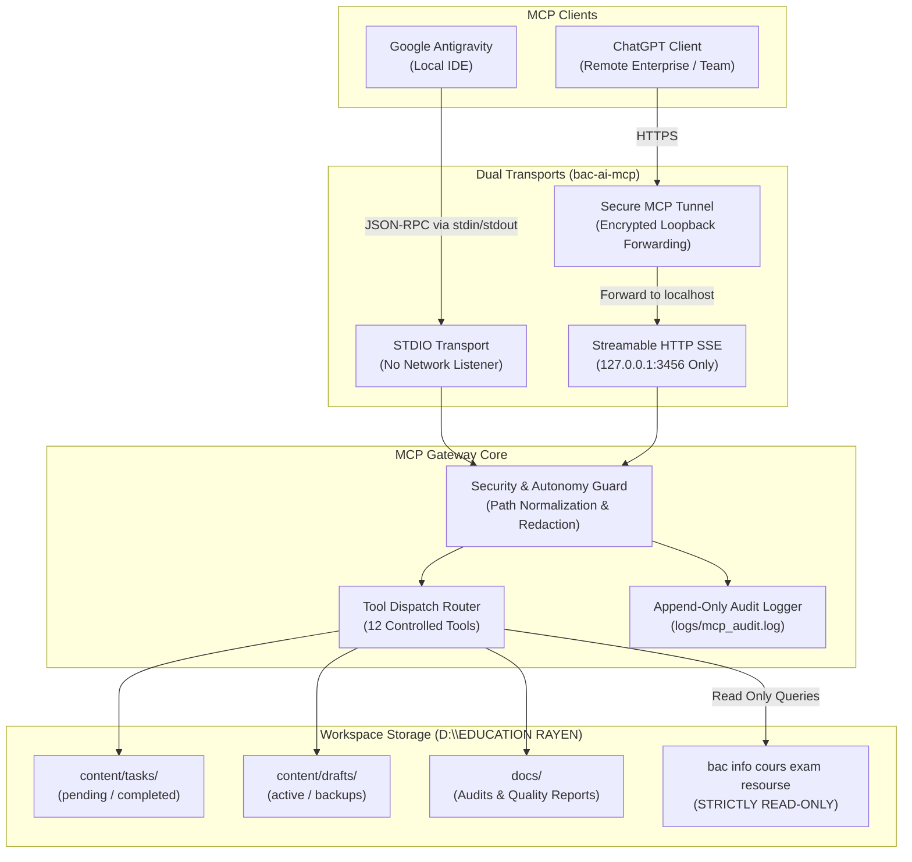
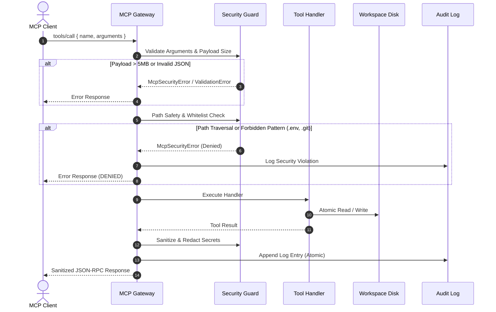

# BAC AI Tunisia — MCP Gateway Architecture

## 1. Architectural Overview

The **BAC AI Tunisia MCP Gateway** (`bac-ai-mcp`) is an isolated, secure protocol adapter that enables AI coding assistants (Google Antigravity locally and ChatGPT remotely) to interact with the BAC AI Tunisia educational platform under strictly enforced pedagogical and security constraints.

---

## 2. Process & Isolation Boundaries

1. **Independent Process Lifecycle**:
   - The MCP Gateway runs as a standalone Node.js process (`dist/stdio.js` or `dist/http.js`), completely decoupled from the Next.js frontend (`bac-ai-studio`).
   - Frontend web crashes or restarts do not disrupt active MCP agent sessions.
2. **Filesystem Decoupling**:
   - The Next.js studio interacts with `content/tasks/` and `content/drafts/` via filesystem persistence.
   - The MCP Gateway writes directly to those approved directories using atomic writes (`.tmp` write followed by atomic rename).
   - Both processes share common schema conventions without sharing `node_modules`.

---

## 3. Dual Transport Design

### A. Local STDIO Transport (`src/stdio.ts`)
- **Primary Client**: Google Antigravity.
- **Protocol**: Standard JSON-RPC 2.0 over process `stdin` and `stdout`.
- **Security Profile**:
  - No network ports are opened.
  - Zero attack surface from external network interfaces.
  - Process inherits environment variables safely from the launching shell.
  - Server startup diagnostics are directed exclusively to `stderr` to preserve clean JSON-RPC protocol messages on `stdout`.

### B. Streamable HTTP SSE Transport (`src/http.ts`)
- **Primary Client**: ChatGPT via Secure MCP Tunnel.
- **Protocol**: Server-Sent Events (SSE) for downstream message streaming, HTTP POST for upstream JSON-RPC requests.
- **Network Binding**:
  - Bound strictly to IPv4 loopback: `127.0.0.1`.
  - Never binds to `0.0.0.0` or public network adapters.
- **DNS Rebinding Defense**:
  - Rejects incoming HTTP requests whose `Host` header does not evaluate to `127.0.0.1` or `localhost`.
- **CORS Restrictiveness**:
  - Whitelists only local loopback origins (`http://127.0.0.1`).

---

## 4. Tool Registry & Autonomy Model

The MCP Gateway registers 12 controlled tools divided into two permitted autonomy tiers. Level 3 actions are permanently barred at the protocol level.

| Tool Name | Autonomy Tier | Permitted Operations | Backup Policy |
| :--- | :--- | :--- | :--- |
| `get_project_status` | **Level 1 (Automatic)** | Read workflow metrics & structure | None (Read-only) |
| `search_knowledge` | **Level 1 (Automatic)** | Query 71 cataloged exam/textbook entries | None (Read-only) |
| `read_knowledge_file`| **Level 1 (Automatic)** | Read approved source by catalog ID | None (Read-only) |
| `list_tasks` | **Level 1 (Automatic)** | Filter tasks in pending/completed | None (Read-only) |
| `get_task` | **Level 1 (Automatic)** | Read task definition by ID | None (Read-only) |
| `list_drafts` | **Level 1 (Automatic)** | Filter drafts in active queue | None (Read-only) |
| `read_draft` | **Level 1 (Automatic)** | Read full draft payload by ID | None (Read-only) |
| `get_quality_report` | **Level 1 (Automatic)** | Read verification markdown reports | None (Read-only) |
| `get_audit_log` | **Level 1 (Automatic)** | Read recent security audit entries | None (Read-only) |
| `create_task` | **Level 2 (Protected)**| Write new task to pending queue | Duplicate ID check |
| `write_draft` | **Level 2 (Protected)**| Write draft to active queue | **Mandatory automated backup** |
| `run_quality_checks` | **Level 2 (Protected)**| Run whitelisted studio test targets | Sandboxed subprocess |

---

## 5. Security Guard Pipeline

Every tool invocation passes through a five-stage verification pipeline before execution:

