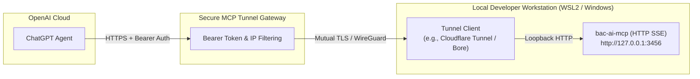

# BAC AI Tunisia — ChatGPT Secure MCP Tunnel Integration Guide

This guide details the security requirements, technical architecture, account limitations, and safe operational procedures for connecting **ChatGPT** to the **BAC AI Tunisia MCP Gateway**.

---

## 1. OpenAI Account & Plan Eligibility

Based on official OpenAI specifications for Custom Actions and Model Context Protocol (MCP) integrations:

| Account Type | Custom MCP Support | Write / Mutation Support | Status |
| :--- | :--- | :--- | :--- |
| **ChatGPT Free** | ❌ Not Supported | ❌ Not Supported | Cannot connect custom MCP servers |
| **ChatGPT Plus** | ⚠️ Custom GPT Actions (Limited) | ⚠️ Webhook Actions Only | Native Streamable HTTP MCP not available |
| **ChatGPT Team** | ✅ Supported (Developer Mode) | ✅ Supported with Confirmation | Eligible for Secure MCP Tunnel |
| **ChatGPT Enterprise**| ✅ Full Enterprise MCP Support | ✅ Supported with RBAC Controls | Recommended for institutional deployment |
| **ChatGPT Edu** | ✅ Full Educational MCP Support | ✅ Supported with Administrative Controls| Recommended for Ministry/University deployments |

> [!IMPORTANT]
> Do NOT attempt to connect a ChatGPT Free account to this server. OpenAI restricts custom local/private MCP server registration to Team, Enterprise, and Edu developer tiers.

---

## 2. Technical Architecture: Secure Loopback Tunneling

The local MCP HTTP transport listens **strictly on loopback**:
`http://127.0.0.1:3456`

To connect a remote ChatGPT client without creating public internet exposure, a **Secure Authenticated Tunnel** must be established.



### Protocol Requirements
1. **Server-Sent Events (`/sse`)**:
   - ChatGPT establishes a persistent downstream HTTP GET connection to `/sse`.
   - The server assigns a unique session ID and streams JSON-RPC responses.
2. **Upstream Commands (`/messages?sessionId={id}`)**:
   - ChatGPT POSTs tool calls to `/messages` referencing its assigned session ID.
3. **Health Check (`/health`)**:
   - Returns JSON status without disclosing system paths or credentials.

---

## 3. Phased Rollout Procedure

When a qualifying ChatGPT Team or Enterprise account is available, proceed in two phases:

### Phase 1: Read-Only Verification (Level 1 Autonomy)
1. Start the HTTP server locally:
   ```bash
   cd /mnt/d/EDUCATION\ RAYEN/bac-ai-mcp
   npm run start:http
   ```
2. Verify loopback response:
   ```bash
   curl http://127.0.0.1:3456/health
   ```
3. Connect the secure tunnel to `127.0.0.1:3456` with an authentication token.
4. Register the tunnel endpoint inside ChatGPT Developer Settings.
5. Test Level 1 read-only tools:
   - `get_project_status`
   - `search_knowledge`
   - `list_tasks`
   - `read_draft`
6. Verify in `bac-ai-mcp/logs/mcp_audit.log` that actor is recorded as `"actor": "http"` and status is `"SUCCESS"`.

### Phase 2: Controlled Writes (Level 2 Autonomy)
1. Write tools (`create_task`, `write_draft`, `run_quality_checks`) are permitted only with explicit teacher oversight.
2. ChatGPT models prompt the user with a confirmation dialog before executing write tools.
3. Every write operation automatically creates an audit entry and safety backup in `content/drafts/backups/`.

---

## 4. Immediate Access Revocation

To revoke ChatGPT's access instantly at any time:

1. **Terminate the Tunnel Process**:
   Killing the tunnel daemon immediately severs the external HTTPS connection.
2. **Stop the HTTP Server**:
   ```bash
   # Terminate the local HTTP process
   pkill -f "dist/http.js"
   ```
3. **Revoke the Authentication Secret**:
   Invalidate the Bearer token in the tunnel configuration and inside OpenAI Developer Settings.

---

## 5. Security Confirmation

> [!NOTE]
> During this implementation, **NO external tunnel was launched, NO public ports were opened, and NO credentials were sent to OpenAI**. The server remains strictly listening on `127.0.0.1`.
